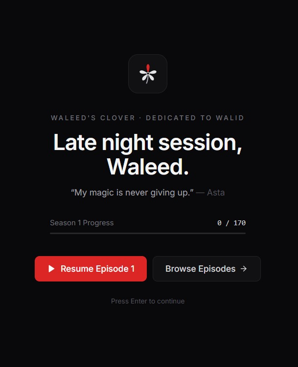
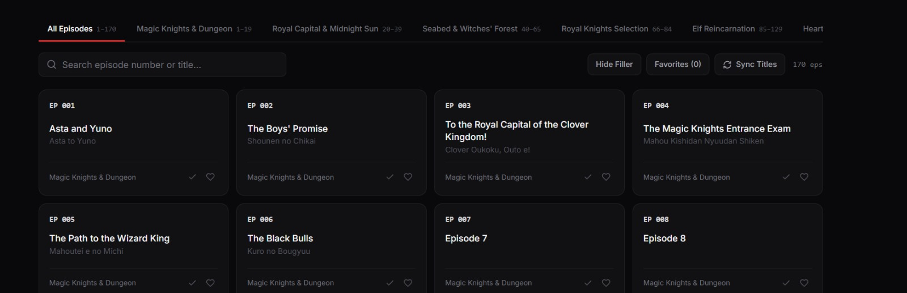

<div align="center">

# Waleed's Clover

**A sleek, dark-mode streaming sanctum built exclusively for *Black Clover* Season 1 (Episodes 1–170) — dedicated to Walid.**

[](https://waleeds-clover-9vlz.vercel.app/)
[](https://nextjs.org/)
[](https://www.typescriptlang.org/)
[](https://tailwindcss.com/)

</div>

---

## Welcome to Your Personal Grimoire

**Waleed's Clover** strips away ads, clutter, and confusing season lists so you can focus on one thing: watching every single episode of *Black Clover* Season 1 (`Ep 1–170`) in a calm, cinema-grade dark interface—with zero sign-up and automatic progress saving in your browser.

---

## How It Works

### 1. Personalized Welcome Curtain & Instant Resume

Every time you open the app, you're greeted with a time-of-day welcome screen, a rotating *Black Clover* quote, and your live Season 1 progress bar (`X / 170`). Click **Resume Episode** (or press `Enter`) to jump straight back to where you left off, or **Browse Episodes** to explore the full list.

<p align="center">
  
</p>

---

### 2. Theater Player, Multi-Server Switching & Synced Subtitles

The 16:9 theater player keeps everything you need right below the video frame without annoying popups or nested menus:

- **3 Stream Servers**: Switch effortlessly between **Server 1 · Primary**, **Server 2 · MAL Mirror**, and **Server 3 · Dub** (`AniList: 97940` / `MAL: 34572`).
- **Synced Arabic & English Subtitles (Ep 1–170)**: Powered by a dual-provider engine (`/api/subtitles`) combining **SubtitleCat** and **OpenSubtitles v3**, with automatic English-to-Arabic translation and RTL punctuation cleanup so **Arabic CC** and **English CC** work on every episode.
- **Subtitle Style & Timing Controls**: Open the **Style** menu to customize **Size** (`S / M / L / XL`), **Background** (`None / Subtle / Box`), **Color** (`White / Yellow`), **Position** (`Low / Standard / High`), and **Timing Sync** (`±0.5s`).
- **Fullscreen with Subtitles & Lights Off**: Use the player's **Fullscreen** button (works on desktop and mobile) to keep synced captions visible in fullscreen, or toggle **Lights Off** to dim the rest of the page.

<p align="center">
  
</p>

---

### 3. Story Arc Tabs, Smart Search & Watch Tracking

All 170 episodes are organized by official *Black Clover* Season 1 story arcs—fetched from **Jikan API v4** (`/api/episodes`), cached locally in `localStorage` for instant reloads, and backed by a built-in offline fallback:

- **Filter by Arc**: Jump straight to any arc using the horizontal tabs below the player.
- **Search & Filter**: Search by episode number (like `49` or `99`) or title, toggle **Hide Filler** to stick to canon episodes, or filter your **Favorites**.
- **Automatic Saving**: Watched checkmarks, favorites, last watched episode, server choice, and subtitle style are all saved automatically in `localStorage`.

<p align="center">
  
</p>

---

## Season 1 Story Arcs Guide

| Story Arc | Episodes |
| :--- | :---: |
| **All Episodes** | `1 – 170` |
| **Magic Knights Entrance & Dungeon** | `1 – 19` |
| **Royal Capital & Eye of the Midnight Sun** | `20 – 39` |
| **Seabed Temple & Witches' Forest** | `40 – 65` |
| **Royal Knights Selection** | `66 – 84` |
| **Elf Reincarnation Arc** | `85 – 129` |
| **Heart Kingdom & Spade Raid** | `130 – 170` |

---

## Tech Stack & Architecture

| Layer | Technology |
| :--- | :--- |
| **Framework** | [Next.js 15](https://nextjs.org/) (App Router) |
| **Language & UI** | [React 19](https://react.dev/), [TypeScript 5](https://www.typescriptlang.org/), [Tailwind CSS 3](https://tailwindcss.com/) |
| **Icons** | [Lucide React](https://lucide.dev/) |
| **Episode Metadata** | [Jikan API v4](https://jikan.moe/) (`/api/episodes` + `localStorage` cache) |
| **Subtitles Engine** | SubtitleCat + OpenSubtitles v3 (`/api/subtitles`) |
| **Persistence** | Browser `localStorage` (zero external database required) |
| **Hosting** | [Vercel](https://vercel.com/) |

```text
waleeds-clover/
├── screenshots/
│   ├── 01-welcome.png
│   ├── 02-player-arabic-cc.png
│   └── 03-episodes-arcs.png
├── src/
│   ├── app/
│   │   ├── api/
│   │   │   ├── episodes/route.ts   # Server-cached Jikan v4 episode fetcher
│   │   │   └── subtitles/route.ts  # Dual-provider EN/AR subtitle & translation API
│   │   ├── globals.css             # Obsidian dark-mode styles
│   │   ├── icon.svg                # Custom Five-Leaf Clover tab favicon
│   │   ├── layout.tsx              # Inter & Cairo fonts + metadata
│   │   └── page.tsx                # App entry point
│   ├── components/
│   │   ├── EpisodeFilters.tsx      # Story arc tabs, search, Hide Filler, Favorites
│   │   ├── EpisodeGrid.tsx         # Responsive 4/2/1 episode cards
│   │   ├── FiveLeafLogo.tsx        # Custom Five-Leaf Clover SVG mark
│   │   ├── GreetingOverlay.tsx     # Personalized welcome screen
│   │   ├── HeroBanner.tsx          # Continue Watching & progress bar
│   │   ├── Navbar.tsx              # Sticky header with Favorites & progress
│   │   ├── VideoPlayer.tsx         # 16:9 player, servers, EN/AR CC & Style menu
│   │   └── WaleedsCloverApp.tsx    # Main client state orchestrator
│   ├── lib/
│   │   ├── arcs.ts                 # Official Season 1 arcs & 1–170 fallback
│   │   ├── jikan.ts                # Client episode loader & cache
│   │   ├── servers.ts              # AnimeEmbed server builders
│   │   ├── storage.ts              # Watch history & subtitle style persistence
│   │   └── subtitles.ts            # SRT/VTT parser & Arabic BiDi punctuation fixer
│   └── types/
│       └── anime.ts                # TypeScript domain types
├── next.config.ts
├── tailwind.config.ts
└── package.json
```

---

## Run Locally & Deploy

### Local Development

```bash
git clone https://github.com/ziadkarem00/waleeds-clover.git
cd waleeds-clover
npm install
npm run dev
```

Open `http://localhost:3000` in your browser.

### Deploy to Vercel

1. Push the repository to GitHub.
2. Import it in [Vercel](https://vercel.com/new) using the default **Next.js** preset.
3. Click **Deploy** — no environment variables or database setup needed.

---

<div align="center">

© 2026 [Ziad Karem (@ziadkarem00)](https://github.com/ziadkarem00) · All rights reserved.

</div>